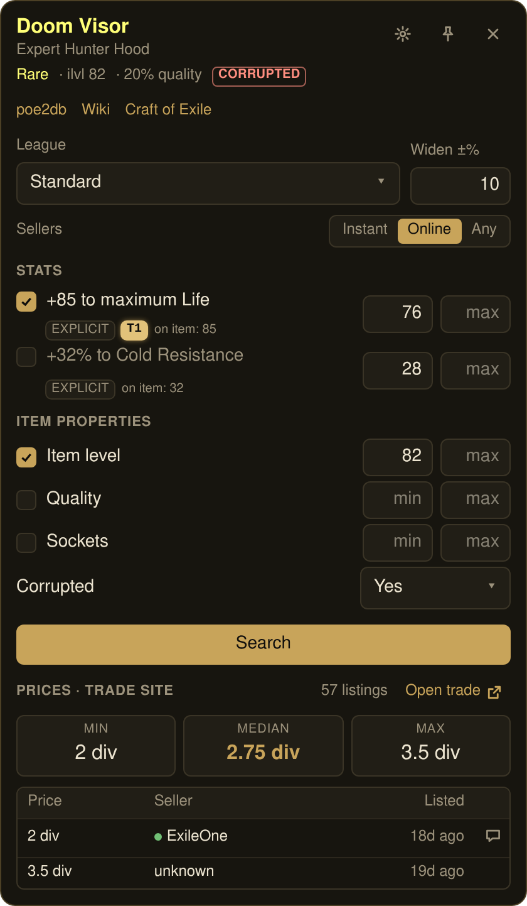
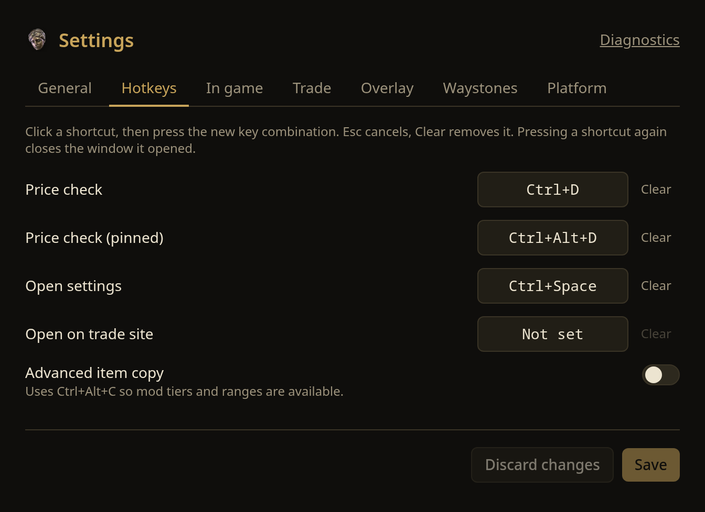
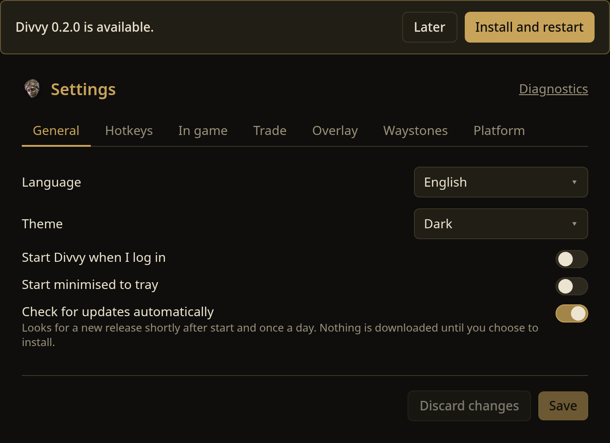
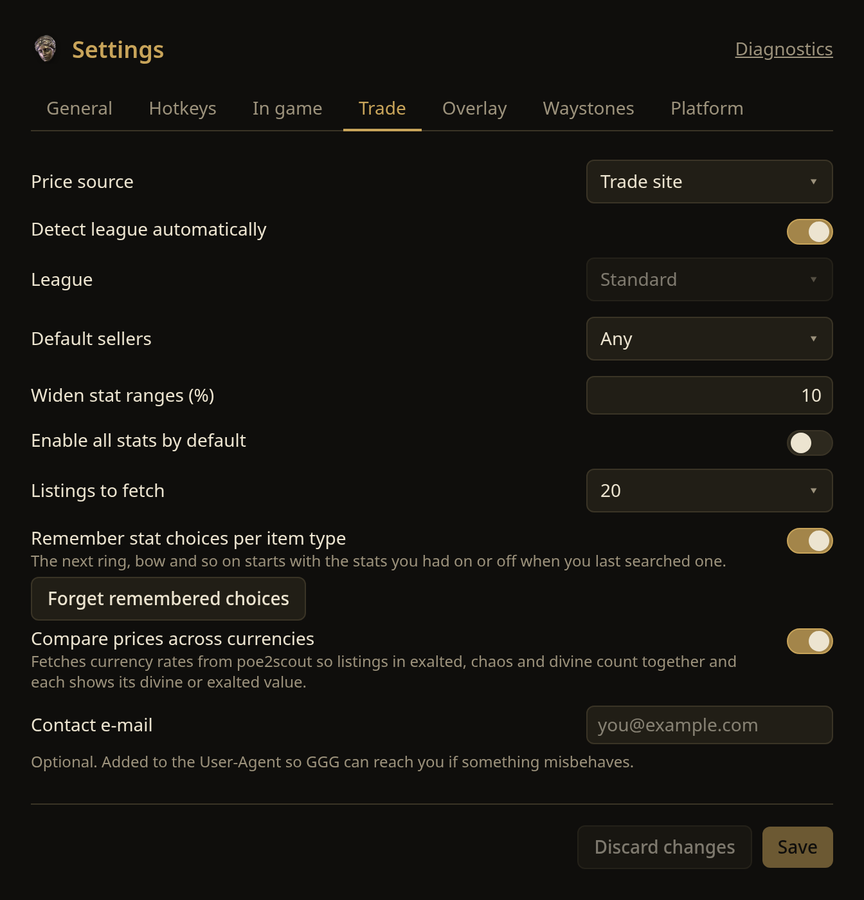
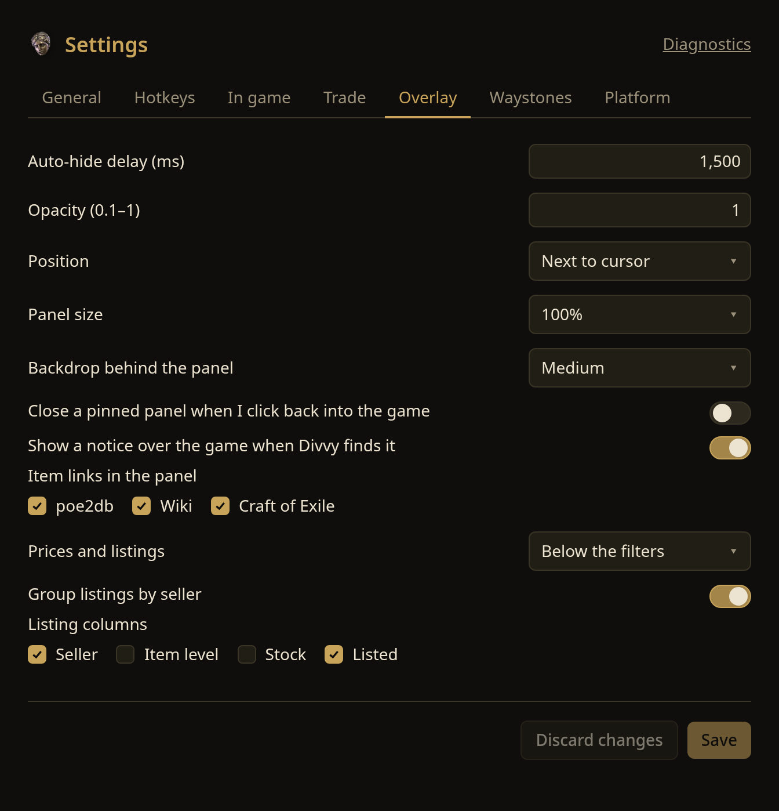
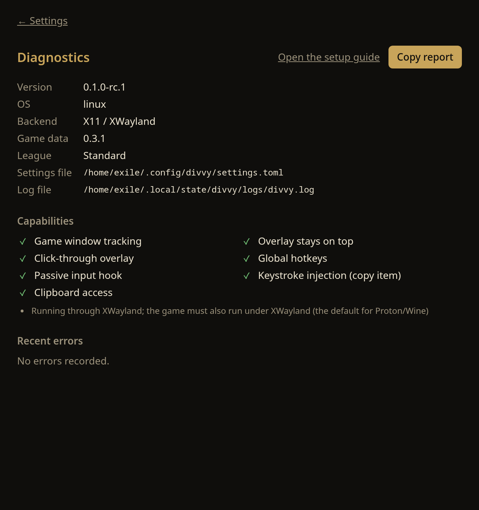
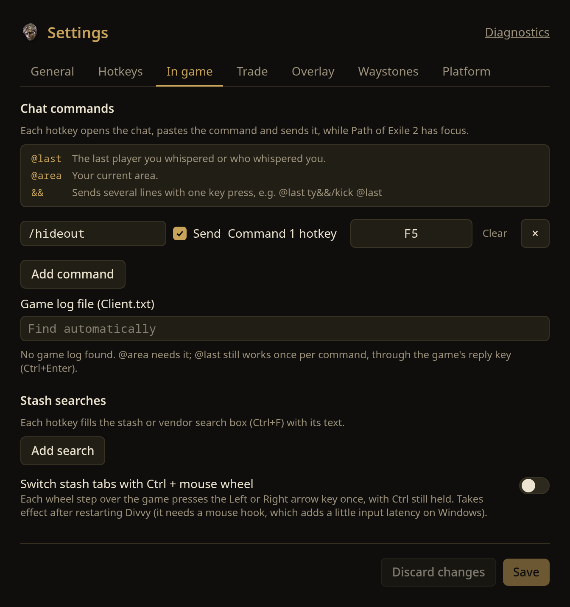

<p align="center">
  
</p>

<h1 align="center">Divvy</h1>

<p align="center">An open-source price-check overlay for <b>Path of Exile 2</b>. Go + <a href="https://v3.wails.io">Wails</a> + React.</p>

<p align="center">
  <a href="https://github.com/BorrowedMirror/divvy/actions/workflows/ci.yml"><picture><source media="(prefers-color-scheme: dark)" srcset="https://shieldcn.dev/badge/dynamic/json.svg?url=https%3A%2F%2Fimg.shields.io%2Fgithub%2Factions%2Fworkflow%2Fstatus%2FBorrowedMirror%2Fdivvy%2Fci.yml.json%3Fbranch%3Dmaster%26cacheSeconds%3D300&query=%24.message&label=build&logo=githubactions&logoColor=%232088ff&mode=dark&size=sm&variant=outline"></picture></a>
  <a href="https://codecov.io/gh/BorrowedMirror/divvy"><picture><source media="(prefers-color-scheme: dark)" srcset="https://shieldcn.dev/badge/dynamic/json.svg?url=https%3A%2F%2Fimg.shields.io%2Fcodecov%2Fc%2Fgithub%2FBorrowedMirror%2Fdivvy.json%3FcacheSeconds%3D300&query=%24.message&label=coverage&logo=codecov&logoColor=%23f01f7a&mode=dark&size=sm&variant=outline"></picture></a>
  <a href="docs/contributing/releasing.md#provenance"><picture><source media="(prefers-color-scheme: dark)" srcset="https://shieldcn.dev/badge/slsa-level_3.svg?logo=data%3Aimage%2Fsvg%2Bxml%3Bbase64%2CPHN2ZyB4bWxucz0iaHR0cDovL3d3dy53My5vcmcvMjAwMC9zdmciIHZpZXdCb3g9IjAgMCAyNCAyNCIgZmlsbD0ibm9uZSIgc3Ryb2tlPSIjZmY2NzQwIiBzdHJva2Utd2lkdGg9IjIiIHN0cm9rZS1saW5lY2FwPSJyb3VuZCIgc3Ryb2tlLWxpbmVqb2luPSJyb3VuZCI%2BPHBhdGggZD0iTTIwIDEzYzAgNS0zLjUgNy41LTcuNjYgOC45NWExIDEgMCAwIDEtLjY3LS4wMUM3LjUgMjAuNSA0IDE4IDQgMTNWNmExIDEgMCAwIDEgMS0xYzIgMCA0LjUtMS4yIDYuMjQtMi43MmExLjE3IDEuMTcgMCAwIDEgMS41MiAwQzE0LjUxIDMuODEgMTcgNSAxOSA1YTEgMSAwIDAgMSAxIDF6Ii8%2BPHBhdGggZD0ibTkgMTIgMiAyIDQtNCIvPjwvc3ZnPg%3D%3D&mode=dark&size=sm&variant=outline"></picture></a>
  <a href="https://www.apache.org/licenses/LICENSE-2.0"><picture><source media="(prefers-color-scheme: dark)" srcset="https://shieldcn.dev/github/BorrowedMirror/divvy/license.svg?label=licence&logo=apache&logoColor=%23d22128&mode=dark&size=sm&variant=outline"></picture></a>
  <a href="https://www.conventionalcommits.org/"><picture><source media="(prefers-color-scheme: dark)" srcset="https://shieldcn.dev/badge/dynamic/json.svg?url=https%3A%2F%2Fimg.shields.io%2Fbadge%2Fcommits-conventional-blue.json&query=%24.message&label=commits&logo=conventionalcommits&logoColor=%23fe5196&mode=dark&size=sm&variant=outline"></picture></a>
</p>
<p align="center">
  <a href="https://pathofexile2.com"><picture><source media="(prefers-color-scheme: dark)" srcset="https://shieldcn.dev/badge/path_of_exile-2.svg?logo=ri%3AGiCrossedSwords&logoColor=%23af6025&mode=dark&size=sm&variant=outline"></picture></a>
  <a href="#windows-1011"><picture><source media="(prefers-color-scheme: dark)" srcset="https://shieldcn.dev/badge/windows-10%20%7C%2011.svg?logo=ri%3ARiWindowsFill&logoColor=%230078d4&mode=dark&size=sm&variant=outline"></picture></a>
  <a href="#macos-12"><picture><source media="(prefers-color-scheme: dark)" srcset="https://shieldcn.dev/badge/macos-12%2B.svg?logo=apple&logoColor=%23ffffff&mode=dark&size=sm&variant=outline"></picture></a>
  <a href="#linux"><picture><source media="(prefers-color-scheme: dark)" srcset="https://shieldcn.dev/badge/linux-x11%20%7C%20wayland.svg?logo=linux&logoColor=%23fcc624&mode=dark&size=sm&variant=outline"></picture></a>
  <a href="go.mod"><picture><source media="(prefers-color-scheme: dark)" srcset="https://shieldcn.dev/badge/dynamic/json.svg?url=https%3A%2F%2Fimg.shields.io%2Fgithub%2Fgo-mod%2Fgo-version%2FBorrowedMirror%2Fdivvy.json%3FcacheSeconds%3D300&query=%24.message&label=go&logo=go&logoColor=%2300add8&mode=dark&size=sm&variant=outline"></picture></a>
  <a href="https://v3.wails.io"><picture><source media="(prefers-color-scheme: dark)" srcset="https://shieldcn.dev/badge/wails-v3.svg?logo=wails&logoColor=%23df0000&mode=dark&size=sm&variant=outline"></picture></a>
</p>

---

Hover an item in game, press **Ctrl+D**, and Divvy copies the item text, parses it, queries
the official trade API and shows a price panel beside your cursor. **Ctrl+Alt+D** opens a pinned
panel that does not auto-hide; **Ctrl+Space** opens the settings. All three can be rebound.

> Divvy only reads what the game puts on the clipboard after the single, user-triggered copy
> keystroke. It never reads game memory, never automates gameplay and never uses OCR.

## Screenshots

<p align="center">
  
</p>
<p align="center"><sub>A price check: the item's stats become editable trade filters, with the prices and the cheapest listings below.</sub></p>

<table>
  <tr>
    <td width="50%" valign="top"></td>
    <td width="50%" valign="top"></td>
  </tr>
  <tr>
    <td align="center"><sub>Every hotkey can be rebound.</sub></td>
    <td align="center"><sub>Signed updates, installed only when you choose.</sub></td>
  </tr>
  <tr>
    <td width="50%" valign="top"></td>
    <td width="50%" valign="top"></td>
  </tr>
  <tr>
    <td align="center"><sub>Price source, league, sellers and filters.</sub></td>
    <td align="center"><sub>Where the panel goes and what it shows.</sub></td>
  </tr>
  <tr>
    <td width="50%" valign="top"></td>
    <td width="50%" valign="top"></td>
  </tr>
  <tr>
    <td align="center"><sub>Diagnostics shows what each platform supports.</sub></td>
    <td align="center"><sub>Chat commands and stash searches on hotkeys.</sub></td>
  </tr>
</table>

Every other view, including diagnostics and setup on Windows, macOS and Linux, is in [docs/screenshots.md](docs/screenshots.md).

## Features

- Every PoE2 item class: currency, gems, uniques, rares, magic, waystones, tablets, jewels,
  flasks and charms.
- Editable filters: per-stat min/max, global ±% widening, online-only, league; "open on trade".
- Price sources: official trade2 API (default), poe.ninja, poe2scout.
- Header-driven rate limiting that respects GGG's `X-Rate-Limit-*` and `Retry-After` headers.
- Settings window, tray icon, hotkey rebinding, league auto-detect, diagnostics page.
- Hotkeys are only taken while the game window has focus, so the same keys keep working in
  other apps (Wayland-native excepted: the portal holds them all the time).

## Requirements

The game must run in **windowed** or **borderless windowed** mode. Exclusive fullscreen hides
overlays on Windows and Linux.

### Windows 10/11
Run the per-user setup `.exe` (no administrator rights needed). It installs WebView2 when it is
missing; Windows 11 already has it. Nothing else is required.

### macOS 12+
Install the DMG (universal binary). macOS gates the overlay behind privacy permissions, granted
in System Settings → Privacy & Security to the Divvy app (in development: to the terminal
that runs the binary):

| Permission | Why | Without it |
| --- | --- | --- |
| Accessibility (required) | send the copy keystroke; AX events for window tracking | no price check from the hotkey; window tracking falls back to polling |
| Screen & System Audio Recording (recommended) | read other apps' window titles (macOS hides them otherwise); Divvy never captures the screen | the game window is matched by process name instead of title |
| Input Monitoring (optional) | passive keyboard hook (Esc to close) | no Esc-to-close (Accessibility alone also enables the hook) |

Global hotkeys and the clipboard need no permission. Without a permission Divvy keeps
running with that capability disabled, and **Diagnostics** (tray menu) lists what is missing.
It never crashes or busy-loops waiting for permissions. Screen Recording and Input Monitoring
usually take effect only after a relaunch. Details: [docs/research/macos.md](docs/research/macos.md).

The native macOS client copies items with **Cmd+C**, which Divvy sends by default; for the
Windows client under CrossOver/Wine set `DIVVY_MACOS_COPY_MODIFIER=ctrl`.

### Linux
An x86_64 AppImage is provided.

Divvy picks a backend at start-up: the **Settings → Platform** override, else
`DIVVY_BACKEND`, else auto-detection. Auto-detection chooses X11 whenever `DISPLAY` is set
(XWayland running, GNOME included), Wayland-native when only `WAYLAND_DISPLAY` /
`XDG_SESSION_TYPE=wayland` is present, and X11 otherwise. `GDK_BACKEND` is set to match before
GTK starts.

| Session | Support |
| --- | --- |
| **X11** | Full support. |
| **Wayland + XWayland** (`DISPLAY` set; default on KDE, sway, Hyprland with XWayland enabled) | Full support: Divvy runs through XWayland (`GDK_BACKEND=x11`). PoE2 under Proton/Wine also runs through XWayland. |
| **GNOME** (Wayland or X11) | **X11/XWayland by default.** GNOME does not implement `wlr-layer-shell`, so a forced Wayland-native overlay cannot stay above the game. |
| **Wayland-native** (no XWayland, or `DIVVY_BACKEND=wayland`) | Degraded: overlay anchored to the output via layer-shell (no game-window tracking); hotkeys via the XDG GlobalShortcuts portal; keystroke injection via the virtual-keyboard protocol (wlroots compositors) or `ydotool` (needs `ydotoold`); no passive input hook. |

**Compositor shortcut fallback.** When global hotkeys are unavailable, bind a compositor
shortcut to `divvy --trigger` (price check) or `divvy --trigger --pinned` (pinned
panel). The command hands the request to the already running instance (Divvy allows only
one instance per user) and exits; `pkill -USR2 divvy` (price check) and `pkill -USR1
divvy` (pinned) work too.

## Configuration

Settings live in `settings.toml` in the per-OS config directory:

| OS | Settings | Cache | Logs |
| --- | --- | --- | --- |
| Windows | `%APPDATA%\divvy\config\settings.toml` | `%LOCALAPPDATA%\divvy\cache` | `%LOCALAPPDATA%\divvy\data\logs` |
| macOS | `~/Library/Application Support/app.divvy/settings.toml` | `~/Library/Caches/app.divvy` | `~/Library/Application Support/app.divvy/logs` |
| Linux | `$XDG_CONFIG_HOME/divvy/settings.toml` (`~/.config/divvy`) | `$XDG_CACHE_HOME/divvy` (`~/.cache/divvy`) | `$XDG_STATE_HOME/divvy/logs` (`~/.local/state/divvy/logs`) |

The log file is `divvy.log` (rewritten on every start). The Diagnostics page shows the
settings and log paths.

GGG asks API clients to identify themselves; add your contact e-mail in
**Settings → Trade → Contact** and it is appended to the User-Agent.

### Environment variables

| Variable | Effect |
| --- | --- |
| `DIVVY_CONFIG_DIR` | Put everything under one root (portable mode, tests): `<root>/config/settings.toml`, `<root>/cache`, `<root>/logs`. |
| `DIVVY_BACKEND` | Force the platform backend: `x11` (or `xwayland`), `wayland`; also `windows`, `macos`, `fake`. Case-insensitive; unknown values are ignored; the Settings → Platform override wins. |
| `DIVVY_LOG` | Log level: `debug`, `info` (default), `warn` or `error` (`trace` counts as `debug`). |
| `DIVVY_MACOS_COPY_MODIFIER` | macOS only. Copy-chord modifier: `cmd` (default, native client) or `ctrl` (CrossOver/Wine). |

Development and test-only variables:

| Variable | Read by | Effect |
| --- | --- | --- |
| `DIVVY_TEST_HOOK` | test-hook builds (`-tags testhook`) | Port of the localhost test hook (protocol in [CONTRACTS.md](CONTRACTS.md#test-hook)). |
| `DIVVY_TEST_HOOK_PORT_FILE` | test-hook builds | File the hook writes its bound port to (for `DIVVY_TEST_HOOK=0`). |
| `DIVVY_TEST_HOOK_TOKEN` | test-hook builds | When set, every hook connection must send `auth <token>` first. |
| `DIVVY_TRADE_BASE_URL` | test-hook builds | Trade API base URL, no trailing slash (default `https://www.pathofexile.com`); its host is also allowed for *open on trade*. Release builds ignore it. |
| `DIVVY_NINJA_BASE_URL`, `DIVVY_SCOUT_BASE_URL` | test-hook builds | poe.ninja and poe2scout base URLs (defaults `https://poe.ninja`, `https://poe2scout.com`). Release builds ignore them. |
| `DIVVY_CORPUS_DIR` | `e2e/cmd/fake-game` | Corpus directory for `--corpus-id` (same as `--corpus-dir`). |
| `DIVVY_E2E_*` | e2e tests | Binary paths, how the price check is triggered, where logs are kept; listed in `e2e/doc.go`. |
| `SKIP_BUILD`, `E2E_DISPLAY`, `E2E_XWAYLAND` | `e2e/scripts` | Reuse the built binaries; the Xvfb display (default `:99`); run the clients on XWayland under sway. |
| `DIVVY_RELEASE_VERSION` | `cmd/release package` | Version to package instead of the `VERSION` file. |
| `DIVVY_UPDATER_PUBKEY`, `DIVVY_UPDATER_PRIVATE_KEY` | `cmd/release` | Updater key pair; see [releasing](docs/contributing/releasing.md#updates). |

## Development

```sh
pnpm --dir web install                  # web deps, commitlint, lefthook
pnpm --dir web exec lefthook install    # hooks from .lefthook.yml
pnpm --dir web build                    # the Go binary embeds web/dist
go test -tags gtk3 ./...                # Go tests (Linux; drop -tags gtk3 elsewhere)
pnpm --dir web test                     # web tests
go generate ./...                       # regenerate bindings + commit docs
make dev                                # app with hot reload
make check                              # what CI checks on the Go side
```

See [docs/architecture.md](docs/architecture.md) for an overview,
[CONTRACTS.md](CONTRACTS.md) for the interfaces between the parts,
[CONTRIBUTING.md](CONTRIBUTING.md) for the workflow and
[docs/contributing/commit-message.md](docs/contributing/commit-message.md) for commit rules.

## Licence

Licensed under the [Apache License, Version 2.0](LICENSE).
Path of Exile is a trademark of Grinding Gear Games; Divvy is not affiliated with or endorsed
by Grinding Gear Games. The Divine Orb artwork used as Divvy's icon belongs to Grinding Gear
Games and is not covered by this licence.
